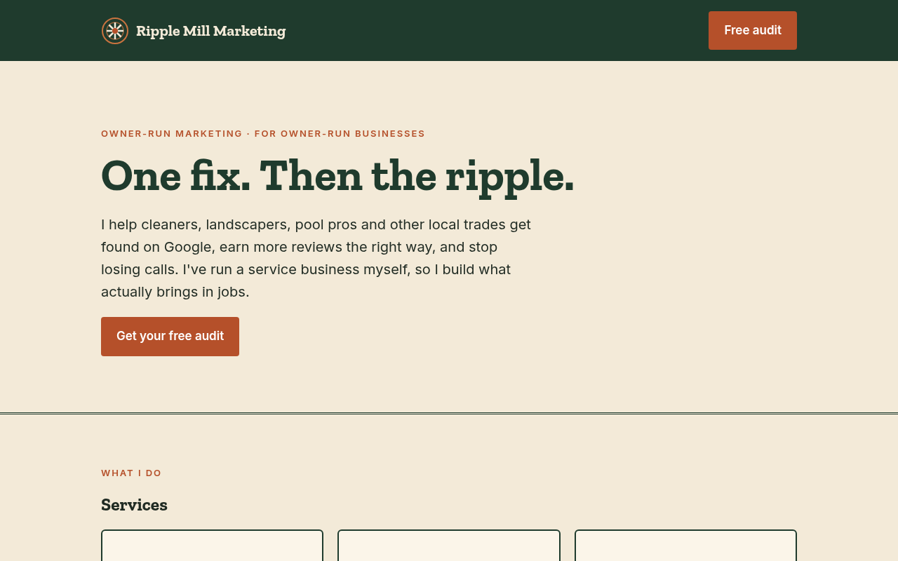

# Ripple Mill Marketing

**One fix. Then the ripple.** The site for Ripple Mill, an owner-run marketing studio: you work with Millz directly, not a handoff.

**Live:** [ripplemill.vercel.app](https://ripplemill.vercel.app) · **Pages mirror:** [jpxgs.github.io/ripplemill](https://jpxgs.github.io/ripplemill/)

## Inside
- Static, zero-build site: `index.html`, web manifest, full favicon set from the Ripple Mill mark
- Palette: forest `#1F3B2D`, cream `#F3EAD8`, rust `#B5502A`
- SEO: structured meta, Open Graph image (`og.png`), `sitemap.xml`, `robots.txt`
- Sections: services, start-free pricing, written guarantees, expertise, studies

## Run locally
```sh
python3 -m http.server 8000
```

Built by [Millz](https://github.com/jpxgs) · [Millzbot](https://millzbot.vercel.app)
